# Redesign review guide

This guide is for the review of the UI redesign pull request into `ui-redesign`. It says what the PR is, what changes for the user in each area, where the code is, and how the work was checked. Two companion files hold the detail:

- [LOGIC_CHANGES.md](LOGIC_CHANGES.md): every change outside pure UI, with code locations.
- [DIFFERENCES_FROM_UPSTREAM.md](DIFFERENCES_FROM_UPSTREAM.md): every place where the PR replaces recent upstream work on purpose, the code that is upstream's again after review, the changed tests, and the Jest status.

State described: the PR after the review rounds of 2026-11-17 to 2026-11-24 (`redesign` `c82b61e9` plus the R17 commit `e2e43572`), merged with upstream `430268ad`.

## 1. Summary

### What the PR is

- A new UI for the whole app: signed out, Home, asset detail, Receive, Send and Convert, requests, VerusID, Services, Scan and Settings.
- One design system: semantic light and dark theme, Inter typography, shared components, bottom sheets, safe-area footers. The rules are in [`DESIGN.md`](../../DESIGN.md) and [`TYPOGRAPHY.md`](../../TYPOGRAPHY.md); `pnpm check:design` enforces part of them.
- The logic changes the new screens need, and fixes found while testing them. They are listed one by one in [LOGIC_CHANGES.md](LOGIC_CHANGES.md).
- Size: 984 files, about +144,800 / -26,300 lines against `upstream/ui-redesign` `430268ad`. Each merge subject names one change; most merge bodies give the reason. The answers to the review are in [Review items](#review-items).

### What the PR is not

- Not a rewrite of wallet logic. Key derivation, hashing, encryption algorithms, coin channels and the Redux store layout stay. Changes in those files are listed in [LOGIC_CHANGES.md](LOGIC_CHANGES.md).
- No version change: app version, build number, bundle id, signing, React Native 0.77.3, the verus library versions, `VRPC_API_APP_ID` and the env values are the upstream values.
- No feature flag. The redesigned UI is the only path. Legacy screen files remain in the repository; nothing mounts them (list in [section 4](#4-known-gaps-and-risks)).
- Not fully green on Jest. Unit suites on the merged branch (2026-11-24): 2979 of 2982 pass. The 3 failures are 2 tests of an upstream screen that the redesign replaced (`identityRegistrationScreens`) and 1 `giftCard` test that also failed on upstream. See [Jest status](DIFFERENCES_FROM_UPSTREAM.md#jest-status).

### How to review it, in order

1. Read [Review items](#review-items) below, then "Read these first" in [LOGIC_CHANGES.md](LOGIC_CHANGES.md#read-these-first): the changes on funds, signing, storage and request load.
2. Read [DIFFERENCES_FROM_UPSTREAM.md](DIFFERENCES_FROM_UPSTREAM.md) so that no replaced upstream line looks like an accident.
3. Read the foundation: `App.js`, `src/theme/app/AppThemeProvider.js`, `src/theme/onboarding/tokens.js`, `src/containers/RootStack/`, then the shared components in [section 3](#3-architecture-notes).
4. Walk the areas in [section 2](#2-what-changes-for-the-user) in the app on a testnet profile (VRSCTEST), one area at a time.
5. Read native and build changes last ([LOGIC_CHANGES.md, native and build](LOGIC_CHANGES.md#native-and-build)).

Useful commands:

```sh
git diff --stat upstream/ui-redesign HEAD -- src/containers/<Area>
git log --merges --first-parent --format='%h %ad %s' --date=short upstream/ui-redesign..HEAD
git show <merge-hash>        # most merge bodies give the reason
```

### Review items

One row per item of the review of 2026-11-17 (R1-R25, I1-I7), the code review of 2026-11-18 (the 11 items the reviewer marked) and the performance feedback of 2026-11-20 (F1-F14). "Owner" = the design owner of this PR. "As asked" means the code does what the item asks. Logic rows: [LOGIC_CHANGES.md](LOGIC_CHANGES.md).

| Item | What changed | Where | Reason |
|---|---|---|---|
| R1, I4 | Home rows and the header are memoised; one balance result redraws only its row and the total. The scroll divider is an animated value. | `SignedInWalletHome.js` | As asked. Each result redrew every Home row. |
| R2 | Home keeps the user's order ("My order") by default. Drag to reorder is on Manage assets. A Sort sheet offers other sorts and a reverse button. | `assetOrder.js`, `AssetReorderList.js` | As asked: assets keep their place when balances move. |
| R3 | A clear button in the amount field (Send, Convert, Build the gift). | `AmountInput.js` | As asked. |
| R4 | "View in explorer" on the Sent result page. | `TransactionResult.js` | Owner pick (2026-11-19): Confirm has no txid yet; upstream had the link after the send. |
| R5 | Each namespace price names its currency, under one "Price" heading; no "Free". | `RegistrationDesign.js` | As asked. |
| R6 | A VerusID list refresh keeps the rows; the loader shows only before the first list. | `SignedInVerusIdService.js` | As asked. |
| R7 | Every pending registration can be deleted from its row menu; a signed one warns that the second payment can still confirm. | `deletion.js`, `RegistrationDeleteSheet.js` | As asked. |
| R8 | Every card title carries its network; choosers show the network on its own line. | `cardPresentation.js`, `CardTitle.js` | As asked. |
| R9 | No white page on the way back to Home: the root screen does not freeze, and Home shows its skeleton at once. | `RootStackScreens.js`, `SignedInWalletHome.js` | As asked. Seen in debug builds only. |
| R10 | Tagged invoices show "This lowers your privacy" on Review and Pay with, and "Tag \| Public" on Confirm. | `InvoicePaymentParts.js`, `SendWizardConfirm.js` | As asked. |
| R11, RQ-1 | A verified legacy invoice shows its signer in the header. | `useRequestRequester.js`, `InvoiceInfo.js` | As asked. The reviewer's own link does not verify with the libraries of this PR. |
| R12 | Sheet text fields keep a local draft, so the cursor stays in place. | `SettingsFieldSheet.js`, `useSheetEditSession.js` | As asked. |
| R13 | Every shown and spendable balance is confirmed, as upstream. Pending funds show only as marked history rows, and for Electrum and private cards as "+X pending" on the asset screen. | `shownBalance.js`, `vrpc/updates.js` | Owner decision (2026-11-19): as upstream. |
| R14 | Fiat entry starts empty; the error shows only after input. | `SendWizardAmount.js`, `amountInput.js` | As asked. |
| R15 | No change. Text import exists: Import wallet, "Enter custom seed or private key" (WIF or any text). | `ImportIntro.js`, `importSeed.js` | Owner decision (2026-11-19, 2026-11-20): closed; the owner answered the reviewer. |
| R16 | The Scan NFC read stops the camera and starts Android reader mode first. | `VerusPay.js`, `deeplinkNfc.js` | Code fix made. Not tested on a real card: no Android phone with NFC. |
| R17 | Asset choices are in the encrypted service data `wallet_asset_management`, old format, no migration code. | `assetChoicesStorage.js` | As asked. |
| R18 | The asset discovery cache is in memory only. | `assetDiscoveryCache.js` | As asked. |
| R19, R20, R22 | No new plain key holds a balance or other identifying data. `portfolioRecord` and the price cache are gone; old copies are deleted unread at start. | `legacyPlainKeys.js`, `walletUiStorage.js` | As asked for new data. Upstream's own plain stores are unchanged (question to the reviewer). |
| R21 | Paid-invoice markers are in the encrypted service data. | `paidInvoiceStorage.js` | As asked. |
| R23 | No chart, so no history. | - | Owner decision: later; the chart was then removed (F1). |
| R24 | "Private keys for other wallets"; the old sentence is gone. | `DisplaySeed.js` | As asked. |
| R25 | Each row in these three files states its reason, or says "Reason not recorded". | This folder | As asked. |
| I1, LINK | Manual entry shows in every state of the Link page except while the lookup runs. | `LinkIdentities.js` | Owner pick (2026-11-19). Upstream shows a permanent button. |
| I2 | VRSCTEST uses `v2api.verustest.net` only; no fallback. | `CoinsList.js` | As asked. |
| I3 | `ALLOW_HTTP_GENERIC_RESPONSE_POSTS` decides in release builds too; the file equals upstream. | `responseDeliverySecurity.js` | As asked. |
| I5 | (a) An amount above the balance is refused; amount plus fee above the balance lowers the output by the fee, as upstream. (b) No VRPC minimum. (c) VRPC funding spends confirmed outputs only. | `vrpc/requests/preflight.js`, `getAddressUtxos.js` | (a) Owner decision (2026-11-20): as upstream. (b), (c) as asked for VRPC. Electrum keeps upstream's 546 sat minimum and unconfirmed outputs (question to the reviewer). |
| I6 | No mempool-spend tracking. `getAddressUtxos.js` equals upstream. | `getAddressUtxos.js` | As asked. |
| I7 | A "Bitcoin Testnet4" coin for Electrum tests. ETH and ERC-20 sends ran on Sepolia. | `CoinsList.js` | As asked. |
| OS-2 | The phrase import accepts 12, 15, 18, 21 and 24 words. | `ImportSeed.js` | As asked. |
| TX1 | A fiat amount rounds down to the asset decimals. | `wizardAmount.js` | As asked. |
| TX2 | The pre-conversion cache holds unfiltered transfers. | `prelaunchData.js` | As asked. |
| TX3 | Confirm checks the blocklist on every route. | `SendWizardConfirm.js` | As asked. |
| IS-4 | A partial discovery keeps the found revoke and recover targets, with a note. | `authorityIdentityDiscovery.js` | As asked. |
| PF1 | Home notices scroll with the list. | `SignedInWalletHome.js` | As asked. |
| PF3 | The chart and its caches are removed (F1). | - | The defect cannot occur. |
| GIFT | An "Also included" list shows every gift-card item. | `GiftCardServiceOverview.js` | As asked. |
| BADGE | Status re-reads on return to the list when the block height rose or after an own action. | `SignedInVerusIdService.js` | Status changes only with a block (F14). |
| F1 | No Home chart and no history requests. | - | As asked. |
| F2 | Price logic equals upstream. Home shows "No price data" when no held asset has a price. | `ratesAPIs/*`, `homeNoPriceCaption.js` | As asked. Caption: owner pick (2026-11-20). |
| F3 | Coin screen: one `getinfo` per 60 s; balance and history only on a new height; stops after 5 idle ticks. | `blockHeightPoll.js` | As asked. |
| F4 | No mempool read in VRPC preflight, gift funding or claims. The identity-transfer refusal still reads the mempool, as upstream. | `identityFunds.js` | Owner decision (2026-11-20): keep upstream's identity check. |
| F5 | Send from a card does not ask for other networks until "Change network". A scanned address that the card's network cannot reach loads them at once. | `SendWizardAmount.js` | As asked. |
| F6 | "Est. slippage"; smallest known value "<0.1%"; no "None". | `impactFormat.js` | As asked. |
| F7 | "Advanced form" with its own Confirm, from "More options" in the header. | `useAdvancedFormMenu.js`, `advancedForm.js` | Owner decisions: header menu (2026-11-22), "Self" kept (2026-11-20), no one-time currency disclaimer (2026-11-24). |
| F8 | "via <basket>" on the Convert amount page and on Confirm. | `ViaLine.js` | As asked. |
| F9 | Found assets are only counted on Home; `getcurrency` runs on Manage assets, at most 12 per pass. | `assetManagementService.js` | As asked. |
| F10 | Static currency definitions saved for 1 day; a shown height can be 60 s old. Other `getinfo` reads keep upstream's 1 s cache. | `vrpcCachePolicy.js` | As asked for static data. Reads that need the current height stay live. |
| F11 | `listcurrencies` saved per endpoint and params; refreshed only after 1 hour. | `savedVrpcResponses.js` | As asked. |
| F12 | "Clear cache" and a separate "Clear blockchain data". | `Cache.js` | As asked. |
| F13 | 30 estimates, lowest start block first; "Check 30 more routes" asks the next 30. | `wizardUtils.js` | Owner pick (2026-11-22) for the tap. |
| F14 | Reads follow a new block, an own transaction or a saved copy. Above upstream: Convert estimates (F13), one Confirm estimate retry, market and suggestion samples. | `SendWizardAmount.js`, `usePriceImpact.js` | Partly: the Convert estimates are above upstream (question to the reviewer). |

## 2. What changes for the user

Each area follows the same order: what the user sees now, why it changed, main files, what did not change underneath, how to try it. "Reason not recorded" means no commit or design record states the problem with the old screen.

### 2.1 Signed out and onboarding

**Now.** Landing and Login show a muted background video. Login lists wallets with an avatar and sorts them by last opened; there is no "default wallet". A network caption (Mainnet or Testnet) under the title opens a picker, and the app remembers the last network. Unlock is a sheet with password or biometrics. "Other options" holds import, recovery and "Claim from NFC card". New wallet setup is a stepped flow with the step title in the header, an avatar picker, a backup check with word chips, and one setup screen that shows progress while keys and assets are prepared.

**Why.** "Claim from NFC card" returns: an earlier signed-out redesign had removed both upstream NFC entries, so a gift card on an NFC card could not be claimed with the app alone (iOS does not open `verus://` links from tags). Reason for removing the default wallet: not recorded.

**Main files.** `src/containers/Onboard/`, `src/containers/Login/components/ChooseWalletSheet.js`, `UnlockWalletSheet.js`, `OtherOptionsSheet.js`, `src/components/SignedOutNetworkSelector.js`, `WelcomeBackgroundVideo.js`, `src/components/WalletSetup/WalletSetupOverlay.js`, `src/hooks/useSignedOutNetwork.js`, `src/hooks/useOnboardingSmallDeviceLayout.js`, `src/styles/components/signedOutFlow.styles.js`.

**Not changed underneath.** Seed and key derivation, password storage, biometric storage. `createProfileFromSeed` keeps its write order; the duplicate-profile check runs earlier ([LOGIC_CHANGES.md](LOGIC_CHANGES.md#keys-signing-and-authentication), keys 12).

**Try it.** Sign out. Switch the network caption. Create a wallet on Testnet and go through the backup check. Lock and unlock with password and with biometrics.

| Login | Network picker | Unlock sheet | Other options |
|---|---|---|---|
| 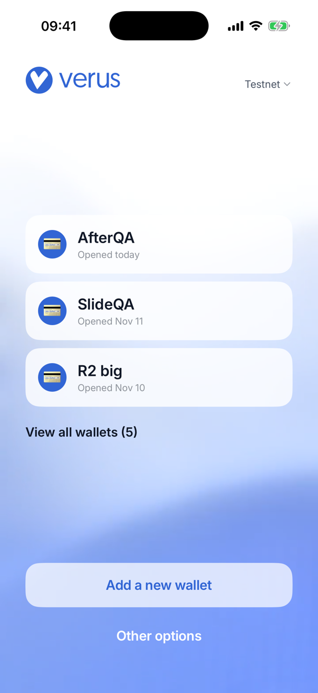 | 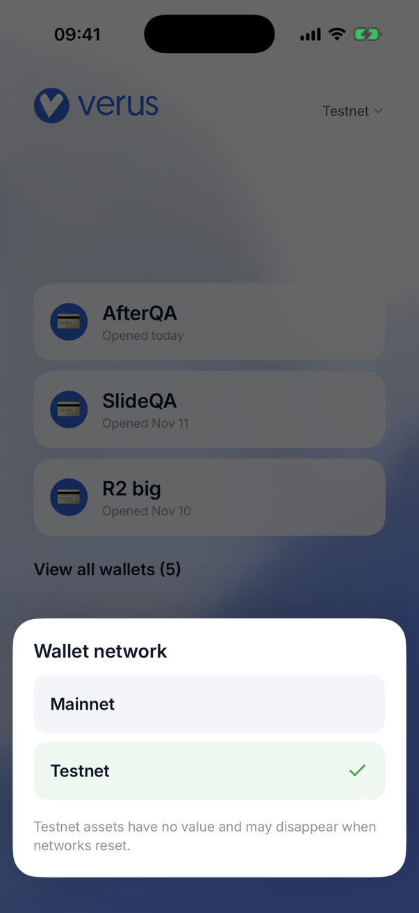 | 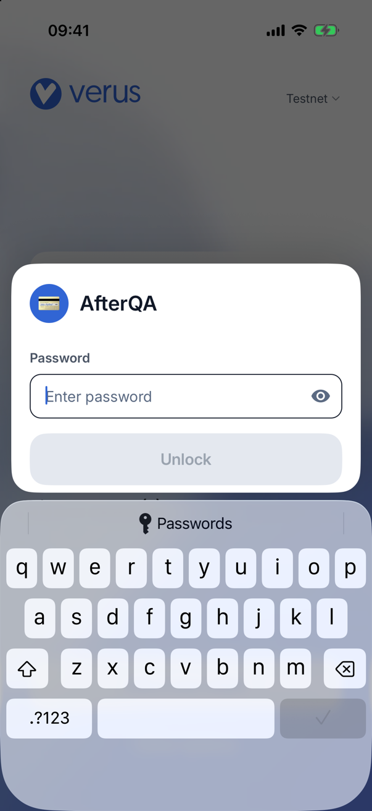 | 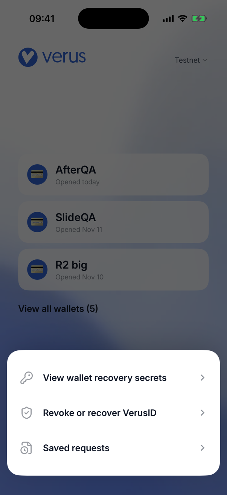 |

### 2.2 Home and portfolio

**Now.** The Wallet tab shows the total value and one row per asset with balance, fiat value and card count. The total counts only the assets with "Show on Home" on; it shows "—" until the saved asset choices are loaded, and "No price data" when no held asset has a price. Assets keep the user's order; a Sort sheet offers other sorts and a reverse button. A header action hides balances; hidden amounts are blurred everywhere, also after a restart. Notices (VerusID registration progress, private wallet sync) scroll with the list. While Home loads, a themed skeleton shows. "Manage assets" adds an asset by identifier, removes an asset at any balance, reorders assets, and offers found currencies without adding them by itself.

**Why.** The goal is to make total value, active assets, card counts and status scannable on one screen. The old Home was a widget board. Upstream had two separate modals for "Add PBaaS currency" and "Add ERC-20 token"; one identifier field replaces both. The total follows the shown rows by design owner decision (`DESIGN.md`). R2: assets keep their place. F1, F2: no chart, upstream prices.

**Main files.** `src/containers/Home/SignedInWalletHome.js`, `components/SignedInWalletSheets.js`, `HomeWidgets/HomeNotice.js`, `HomeWidgets/VerusIdReadyCard.js`, `src/containers/ManageAssets/`, `src/utils/assets/`, `src/components/PrivacyBlurredText.js`.

**Not changed underneath.** Balance, rate and info refresh still run through `Home.js` and the interval channels; prices are upstream's. Balances are confirmed only, as upstream (R13). Asset choices are in the encrypted service data ([storage 1](LOGIC_CHANGES.md#storage-and-migrations)).

**Try it.** Open Home on Testnet. Hide balances, restart, check the blur. Turn "Show on Home" off for one asset and check that the total equals the shown rows. Reorder assets in Manage assets. Add an asset by identifier, then remove it.

| End of asset list | Manage assets |
|---|---|
| 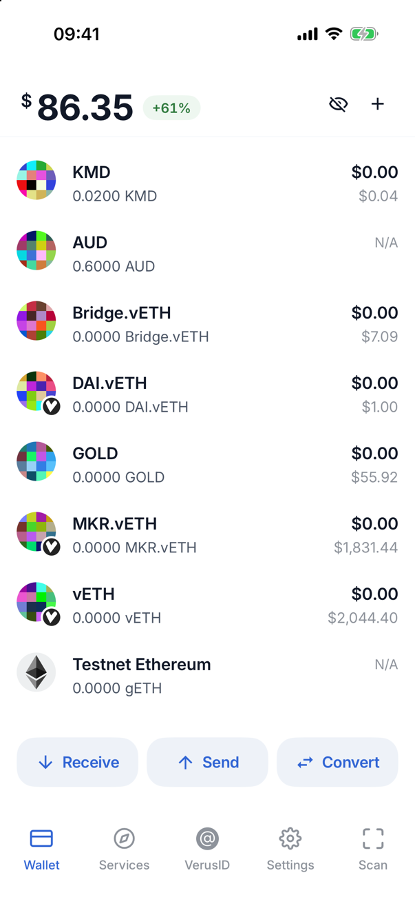 | 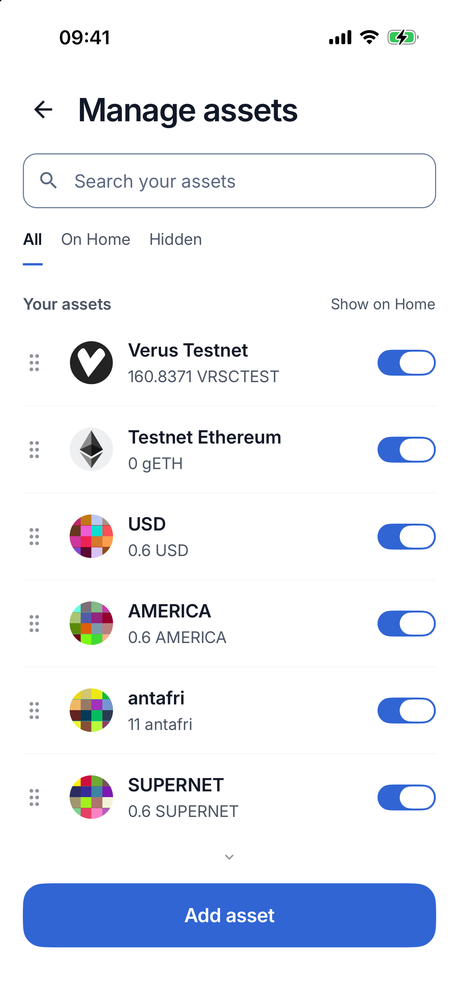 |

Screenshots of 2026-11-16. They show the earlier Home: no sort control, no "No price data" caption.

### 2.3 Asset detail and transactions

**Now.** The asset screen has one top row (back, logo, name, total), a stack of address cards (main, VerusID, private) with up to three pinned cards and the last used card, icon actions (Receive, Send, Convert), and a transactions sheet that stays open under the cards. Each row opens a transaction details sheet (amount, fee, recipient, status, copy). Cards and the total show confirmed funds only, as upstream (R13); an unconfirmed transaction shows as a "Pending" row and badge. Each card title carries its network (R8). On the coin screen, one `getinfo` per 60 s decides when balance and history are read again (F3). Bitcoin-type coins and the private card add "+X pending" next to the confirmed number on the asset screen only. Bridged assets show their origin. Pre-conversions show in their own panel.

**Why.** The design goal is to make address cards first-class: each card shows balance, status and network, and the history follows the selected card. Upstream showed a carousel and a separate details modal (`TxDetailsModal`, now replaced by `TransactionDetailsSheet`).

**Main files.** `src/containers/Coin/SignedInCoinDetail.js`, `SignedInAssetHeader.js`, `AssetCardStack.js`, `CoinCardPickerSheet.js`, `Overview/Overview.js`, `Overview/TransactionDetailsSheet.js`, `BridgedOriginSheet.js`, `PrelaunchAssetPanel.js`, `src/utils/subwallet/`, `src/selectors/transactions.js`.

**Not changed underneath.** The active coin and active card stay explicit and still choose the API channels. Changed: history grouping and fee/recipient derivation for VRPC ([LOGIC_CHANGES.md](LOGIC_CHANGES.md#transaction-building-and-broadcast), broadcast 7), and `null` as the selected card after a card list rebuild ([DIFFERENCES_FROM_UPSTREAM.md](DIFFERENCES_FROM_UPSTREAM.md#decisions-by-the-design-owner)).

**Try it.** Open VRSCTEST from Home. Pin a card, switch cards, open a transaction. Send to yourself and watch the "Pending" row.

| Top | Transactions | Transaction sheet | Transactions, dark |
|---|---|---|---|
| 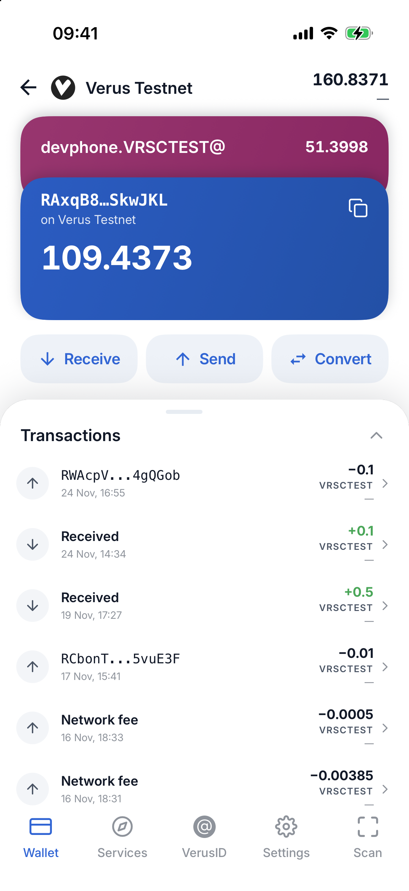 | 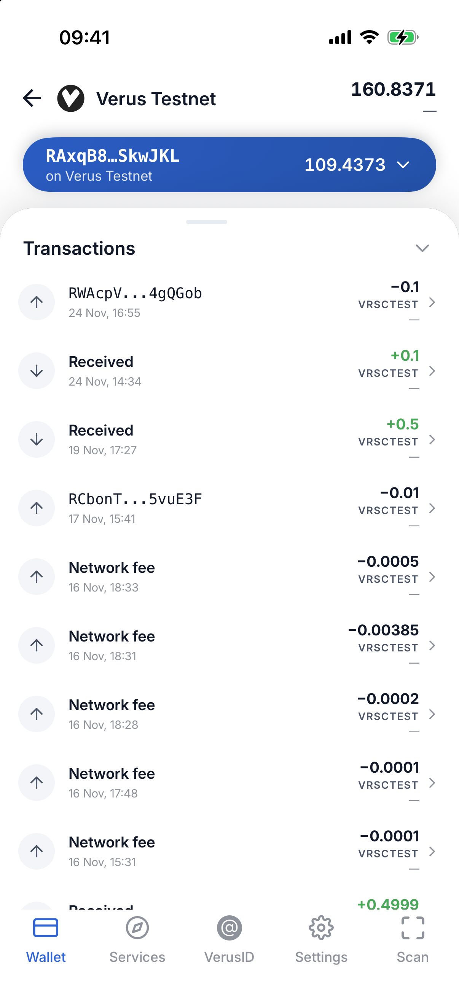 | 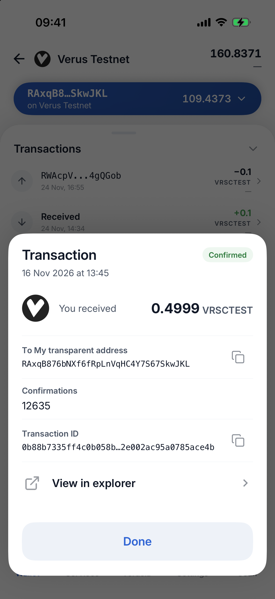 | 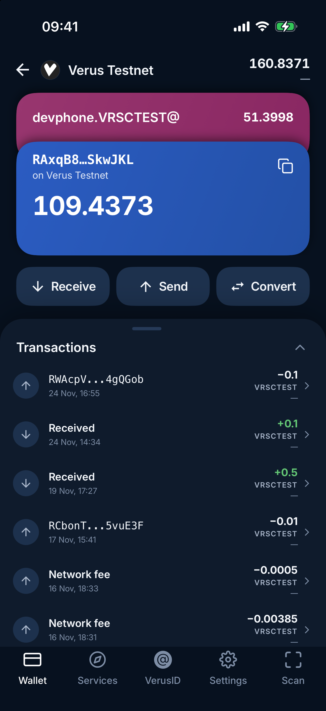 |

### 2.4 Receive

**Now.** Receive starts with an asset list, then one asset screen: the selected card and network, a QR code on a white tile, the address with copy and share, and "Request amount". A payment request is one step (amount, optional note, accepted conversions) and ends on a slip with the QR code and the address or VerusID name.

**Why.** The card chooser was titled "Choose address" although it chooses a card, and the screen claimed support for chains that the selected card did not cover. The payment request link used the deprecated VerusPay v3 invoice; it is now a `GenericRequest` link ([LOGIC_CHANGES.md](LOGIC_CHANGES.md#request-validation), request 1).

**Main files.** `src/containers/Transfer/ReceiveAssetsList.js`, `ReceiveAssetDetails.js`, `ReceiveSubwalletSheet.js`, `ReceiveAddressSheet.js`, `ReceivePaymentRequestFlow.js`, `PaymentRequestSlip.js`, `receiveInvoice.js`.

**Not changed underneath.** Address derivation and the card-to-channel relationship. Invoice fields are the same `VerusPayInvoiceDetails`.

**Try it.** Receive VRSCTEST, change the card, create a request with an amount and a note, scan the slip with a second wallet.

| Asset list | Card chooser | QR and address | Request amount |
|---|---|---|---|
| 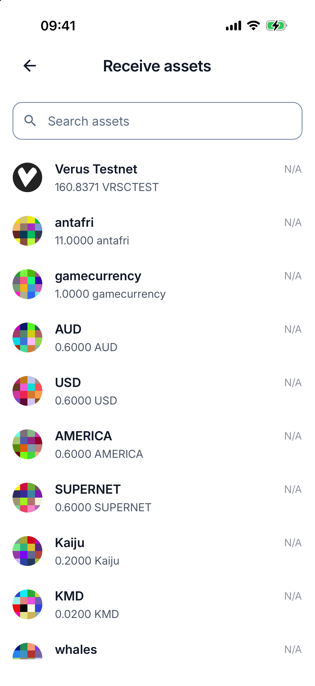 | 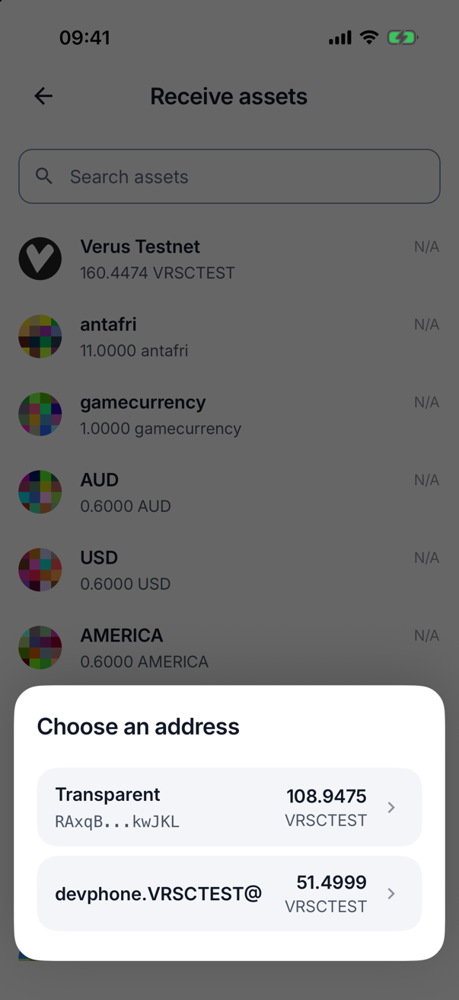 | 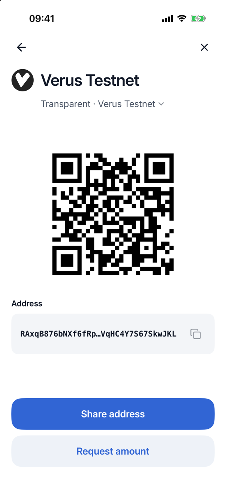 | 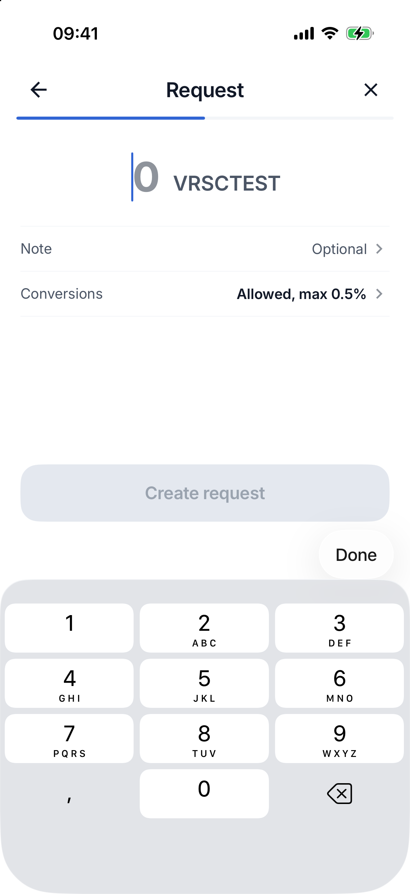 |

| Request ready |
|---|
| 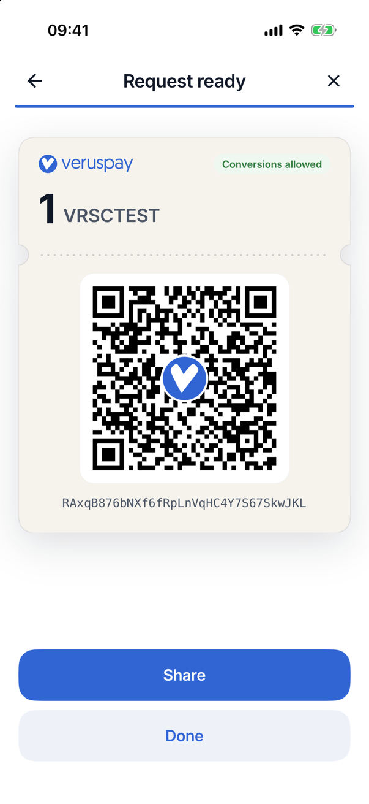 |

### 2.5 Send and Convert

**Now.** One wizard serves Send and Convert: select asset, Amount with an in-app keypad, fiat toggle and clear button, Recipient (address book, paste, scan, live check), Confirm, and a result screen with "View in explorer". Send from a card stays on the card's network until "Change network". Convert shows "Est. slippage" and "via <basket>"; it estimates up to 30 routes and offers "Check 30 more routes". Confirm shows "From", the resolved recipient, fees with money values, the slippage estimate for conversions, and a total; the user confirms with a slide. An amount above the balance is refused. When the amount fits but the fee does not, the fee comes off the amount, as upstream, and Confirm says so. "More options" in the header opens the Advanced form, where every value is entered by hand. Plain ETH, ERC-20 and BTC sends offer a network fee choice (slow, normal, fast, custom). Private (z) sends have a memo. Pre-launch currencies appear in Convert with a countdown. A broadcast that fails after it started shows "status unknown", not "not sent".

**Why.** Upstream had a different send modal per channel (`TraditionalCryptoSend`, `ConvertOrCrossChainSend`, conversion, deposit, withdraw). The wizard gives one flow and one review order. Pre-conversions: a pre-conversion skips Recipient and goes to the card's own address, so a failed launch refunds the same address. Fee choice: approved by the design owner on 2026-10-20; bridge, conversion, Verus and legacy sends keep their old fee path. Network, slippage, route and Advanced form rules: F5-F8, F13 ([Review items](#review-items)).

**Main files.** `src/containers/SendWizard/` (navigator, steps, `invoiceFlow.js`, `privateSend.js`, `priceImpact.js`, `loweredAmount.js`, `useNetworkFee.js`, `advancedForm.js`, `SendWizardAdvanced.js`), `src/components/AmountKeypad.js`, `AmountInput.js`, `SlideToConfirm.js`, `TransactionResult.js`, `src/utils/web3/plainSendFees.js`, `src/utils/preconversion/`.

**Not changed underneath.** The wizard calls the same channel `preflight` and `send` functions with the same source card, channel, route and recipient. Invoice amount, destination and route constraints are kept. Funding spends confirmed outputs only, as upstream. Changed and reviewed separately: ETH/ERC-20 fee path, ambiguous broadcast, request load ([LOGIC_CHANGES.md](LOGIC_CHANGES.md#read-these-first), items 4-6). The balance rule is upstream's and VRPC has no dust minimum (item 1).

**Try it.** Send VRSCTEST to another testnet address. Convert VRSCTEST through a basket. Type an amount above the balance (refused). Send an amount equal to the balance and read Confirm. Send twice in a row before a block: the second send says that nothing new was sent.

Screenshots of 2026-11-16 and 2026-11-17. Amount, Confirm and the Convert screens show the earlier labels (no "Est. slippage", no via line, no header menu).

| Select asset | Choose network | Choose address | Amount keypad |
|---|---|---|---|
| 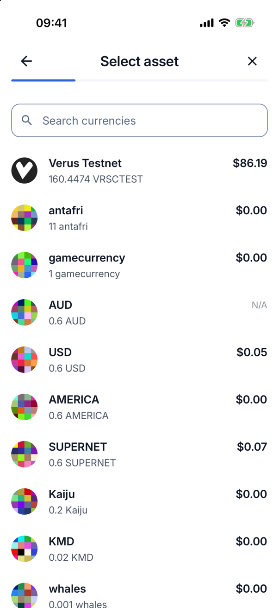 | 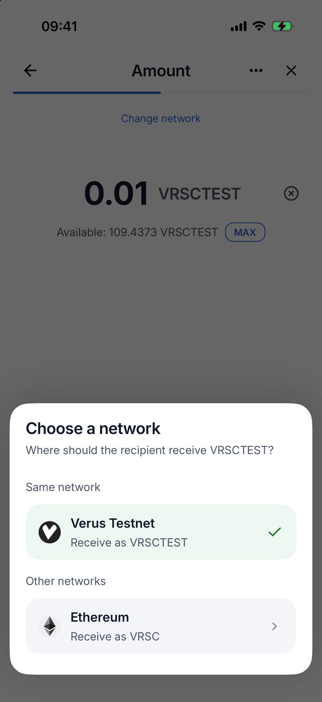 | 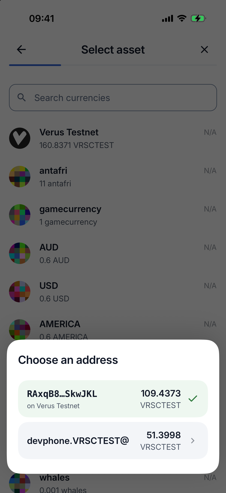 | 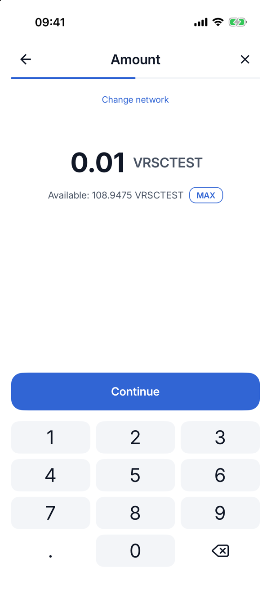 |

| Amount keypad, dark | Recipient, empty | Recipient, filled | Fee sheet |
|---|---|---|---|
| 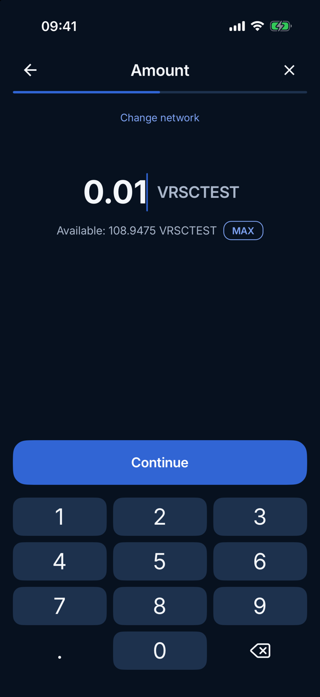 | 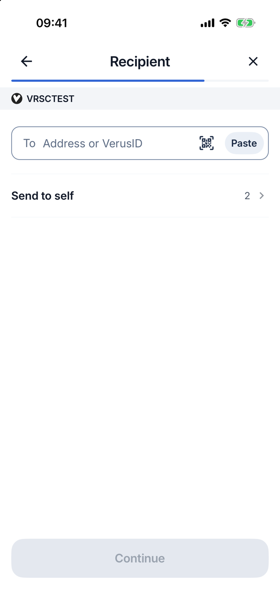 | 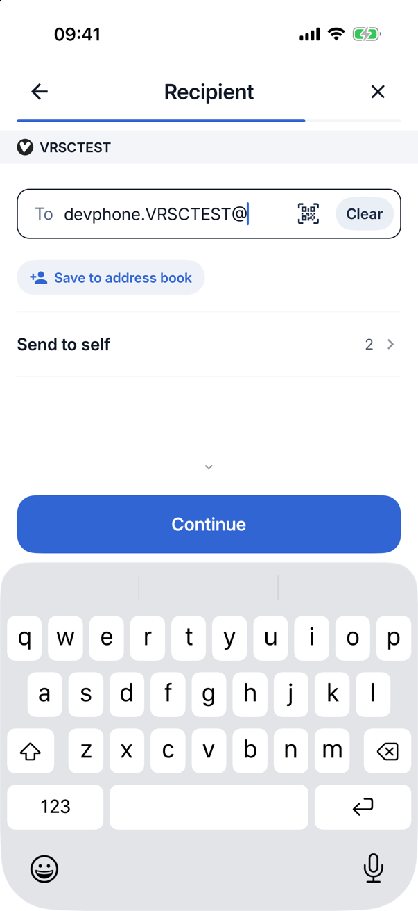 | 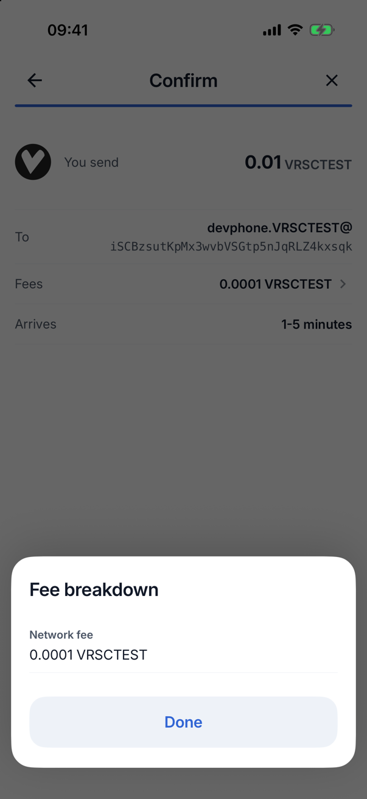 |

| Confirm | Convert: select asset | Convert: target list | Convert: amount, empty |
|---|---|---|---|
| 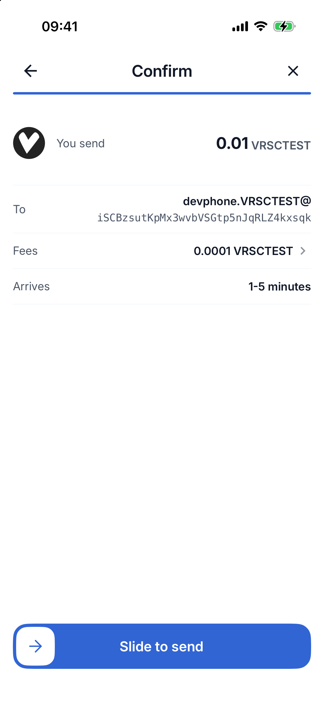 | 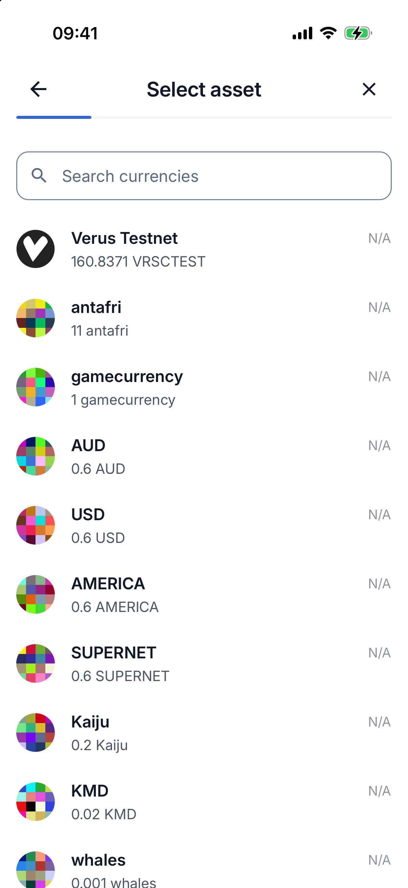 | 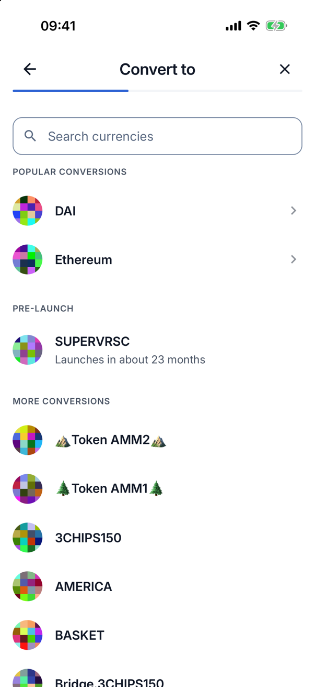 | 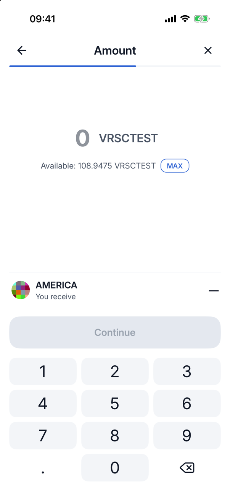 |

| Convert: amount with estimate | Convert: recipient | Convert: send to self |
|---|---|---|
| 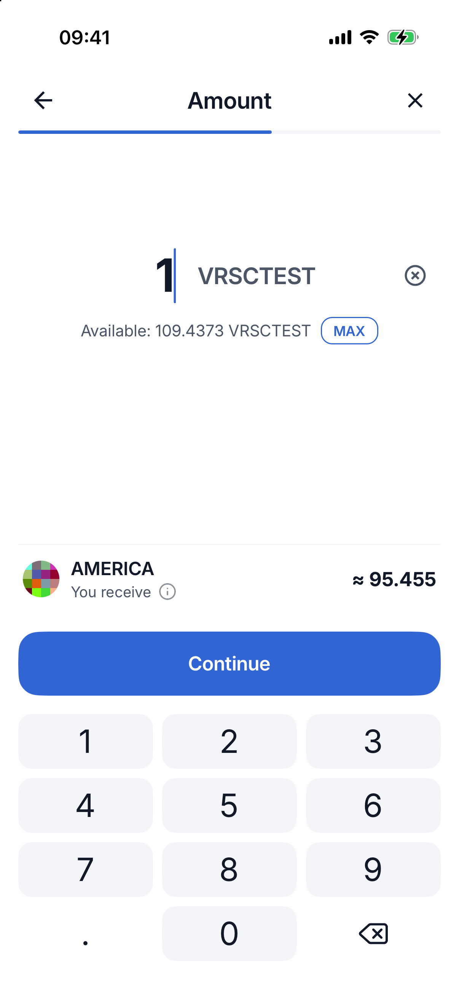 | 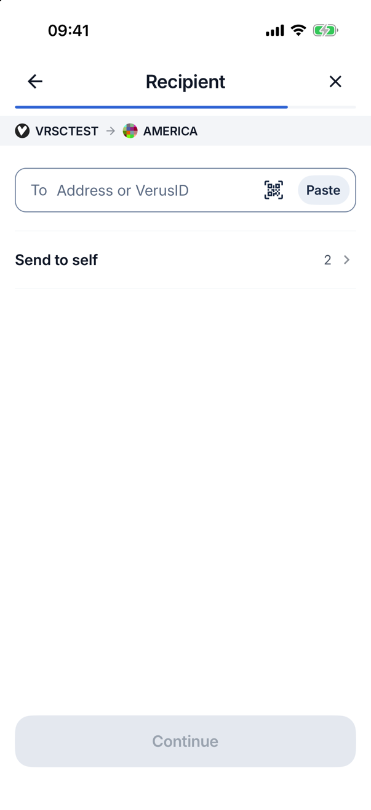 | 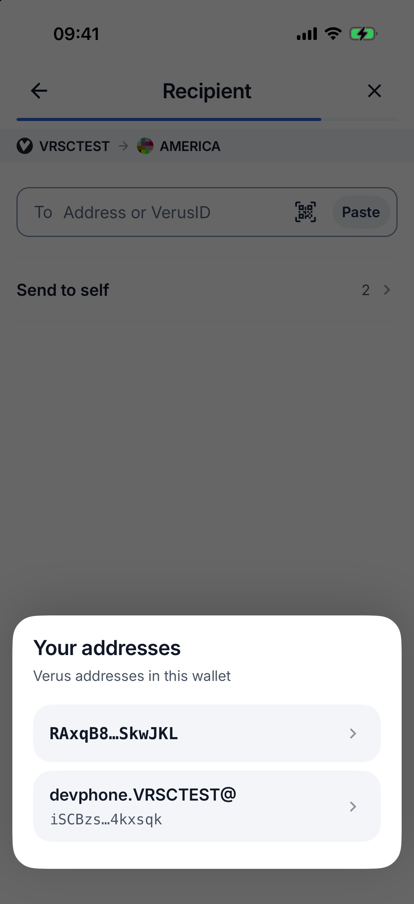 |

### 2.6 Requests and deep links

Covers GenericRequest, sign-in (authentication), identity update, app encryption, credentials and data signing, invoices, gift card claims, wallet backup and NFC.

**Now.** Every request opens in one review layout: a request card with the requester's full name and verification mark, the action, the items, and one approval button. Sign data and Share credentials approve item by item, with Undo. A loader shows while the request is checked. Refused requests show an error state with one sentence and, only where it helps, Retry (for example network failure). Delivery shows its real status: signed, sent, failed. Invoices show the amount, route and fees, warn when this account already paid the invoice, and say when the amount is lowered. A legacy invoice whose signature verifies shows its signer in the header. Identity update requests are a stepped review (content, high-risk changes, confirm) with readable values and a "Keys and authorities" row. Sign-in can provision a VerusID and shows its provisioning state. Gift card claims and NFC reads use a tap screen with one step per phase. A request that needs a wallet asks to unlock the right one.

**Why.** Credential and data-signing requests used hard-coded light styles, card-heavy layouts and dense raw payloads. Some request types reached the old `GenericRequestComplete` screen, which said "Success" before delivery was attempted. Refusals showed raw technical text. Upstream used native alerts for many outcomes.

**Main files.** `src/containers/DeepLink/` (`GenericRequestHome/`, `GenericRequestLoading.js`, `AuthenticationRequestInfo/`, `AppEncryptionRequestInfo/`, `IdentityUpdateRequestInfo/`, `InvoiceInfo/`, `WalletBackupRequestInfo/`, `components/RequestReview/`), `src/components/NfcTap/`, `src/components/WalletUnlockCoordinator.js`, `src/utils/deeplink/genericRequestDelivery.js`, `genericRequestRejection.js`, `delegatedSignerGate.js`.

**Not changed underneath.** Experimental request gating, credential scope filtering, required signer rules, encryption requirements, `assertSignedRequestAuthorization`, per-item consent. Changed and reviewed separately: signing order, one signed response per attempt, fail-closed credentials, early refusal list for identity updates, the verified legacy invoice header ([LOGIC_CHANGES.md](LOGIC_CHANGES.md#keys-signing-and-authentication), keys 1-9, 21).

**Try it.** Open testnet request links (sign-in, identity update, credential, data packet, invoice) from a browser on the device. Open one while the wallet is locked. Open an expired one. Open one twice.

| Identity update request, first step | Content step |
|---|---|
| 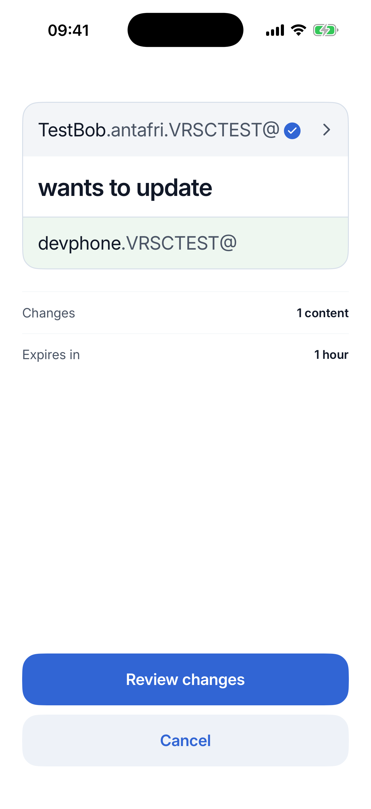 | 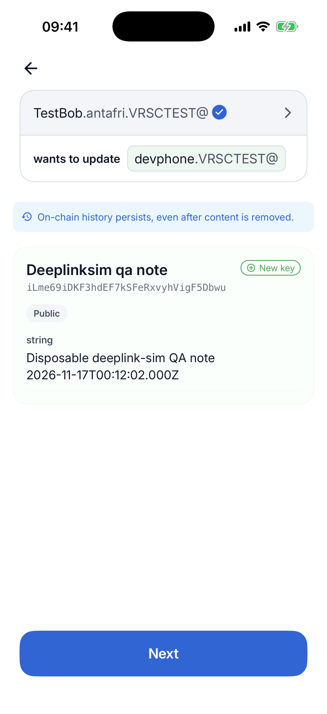 |

Both screenshots come from a real testnet request (content add, signed by a test VerusID) opened on the iOS Simulator on 2026-11-17. The request was not approved. The other request types have no screenshots: they need their own live link or an NFC card.

### 2.7 VerusID

**Now.** VerusID is its own tab. The list shows one row per linked VerusID with a two-tone name, asset count and a status badge only when locked or revoked. A refresh keeps the rows on screen. The VerusID page shows a light card with Receive, Send and Convert, then Control, Content and Details rows, then Funds. "New VerusID" is a stepped flow with name check, payer choice with funds meters, two payment holds, and progress that resumes from Home. "Link VerusID" lists found identities with checkboxes; "Enter VerusID manually" shows in every state except while the lookup runs (I1). Each namespace price names its currency (R5). Every pending registration can be deleted (R7). Modify, Transfer, Revoke and Recover are stepped forms with a summary of every changed key and authority before signing. When saved registrations cannot be read, the tab shows a notice with "Try again" and "Clear all registration data". Status re-reads on return when the block height rose or after an own action.

**Why.** The old page used fold-out details. Status badges replace raw state text. Review R6: a refresh sent the whole list back to the loader (`3290f891`). Upstream's management and registration features (`c9d571d0`, `9ac1c509`) are kept and wired into these screens; the differences are listed in [DIFFERENCES_FROM_UPSTREAM.md](DIFFERENCES_FROM_UPSTREAM.md#upstream-logic-that-the-pr-changes-on-purpose).

**Main files.** `src/containers/RootStack/IdentityStackScreens/IdentityStackScreens.js`, `src/containers/Services/ServiceComponents/VerusIdService/` (`SignedInVerusIdService.js`, `SignedInVerusIdDetails.js`, `VerusIdCard.js`, `LinkVerusIdSheet.js`, `IdentityRegistration/`, `IdentityManagement/`, `IdentityLinking/LinkIdentities.js`), `src/containers/RevokeRecover/`, `src/utils/verusid/`, `src/utils/identityRegistration/`, `src/utils/identityManagement/`.

**Not changed underneath.** Registration transaction building and signing (upstream SDK), revoke and recover funding from the identity address (`check:identity-authority-funding`). Changed: registration retry and wait rules, transfer refusal of own addresses ([LOGIC_CHANGES.md](LOGIC_CHANGES.md#transaction-building-and-broadcast), broadcast 3; funds 17), the registration storage reset (storage 12), the session check on page actions (keys 20).

**Try it.** On Testnet: open the VerusID tab, open a linked identity, Send from it, start "New VerusID" up to the first hold, link an identity, open Modify and go back before signing.

| List | List, dark | Add menu | VerusID page |
|---|---|---|---|
| 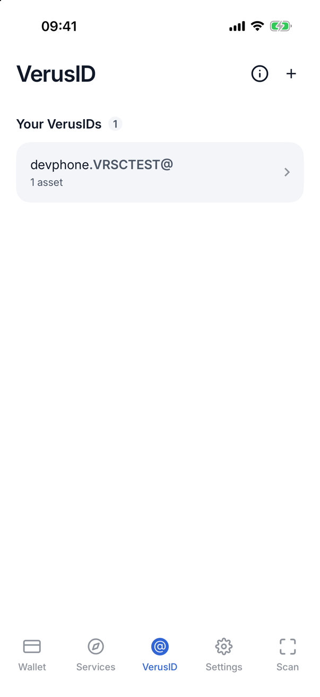 | 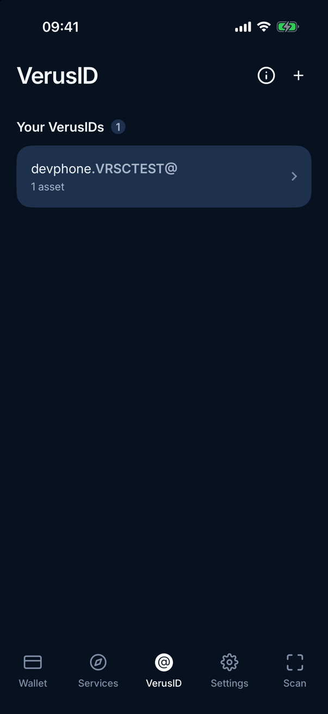 | 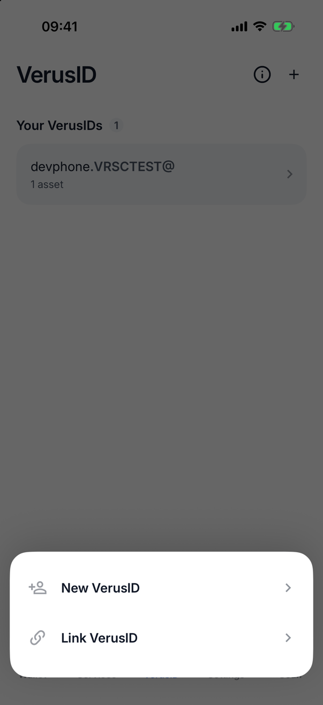 | 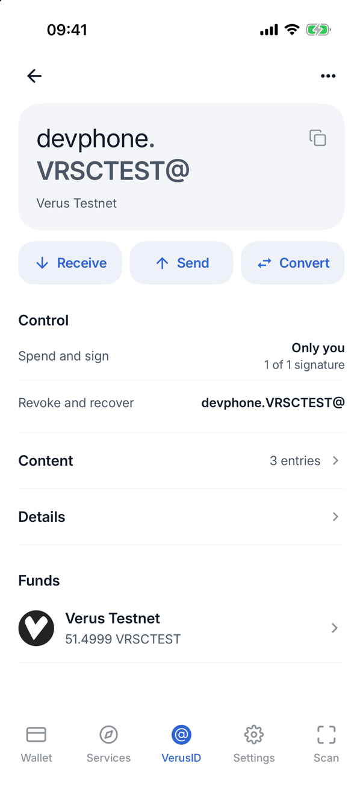 |

| About VerusID sheet | New VerusID, first step | Link VerusIDs |
|---|---|---|
| 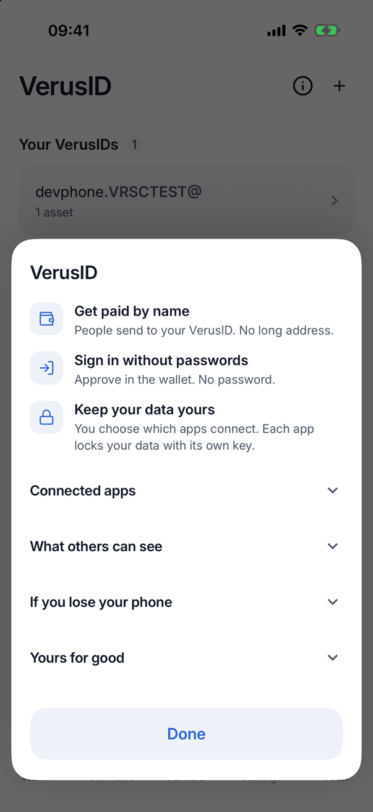 | 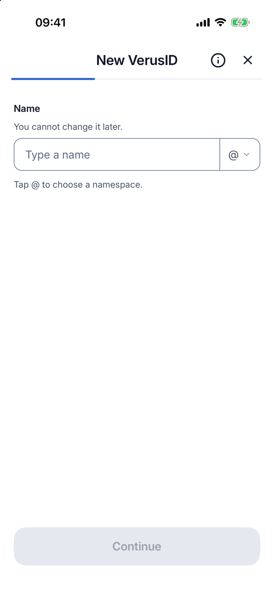 | 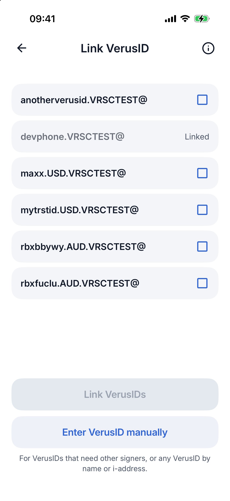 |

### 2.8 Services and gift cards

**Now.** The Services tab shows each service as a tile. Gift cards: "Build the gift" starts with the amount, then funding, an "Also included" list for every item, then a fixed card with status (ready, pending, shared, not funded, redeemed), Share with a QR screen, and NFC write. An address book stores labeled addresses.

**Why.** Reason for tiles: not recorded beyond the design owner's approval on 2026-10-15. The gift card screen states its status once as a badge.

**Main files.** `src/containers/Services/SignedInServicesHome.js`, `ServiceComponents/GiftCardService/` (`GiftCardFixedCard.js`, `GiftCardShareSheet.js`, `GiftCardQrScreen.js`), `src/containers/Services/AddressBook/`, `src/utils/giftCard/giftCardPresentation.js`, `src/utils/addressBook/addressBook.js`.

**Not changed underneath.** Gift card creation, funding and claim transactions. Changed: share reservation ([LOGIC_CHANGES.md](LOGIC_CHANGES.md#funds-and-fees), funds 12). Funding has no mempool pre-check, as upstream.

**Try it.** Create a testnet gift card with a small amount, share it, claim it with a second wallet.

| Services | Gift cards, empty state | New gift card, first step | Gift card warning |
|---|---|---|---|
| 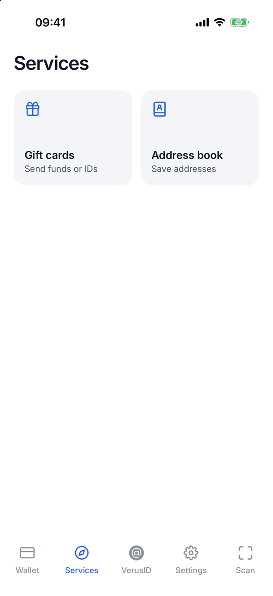 | 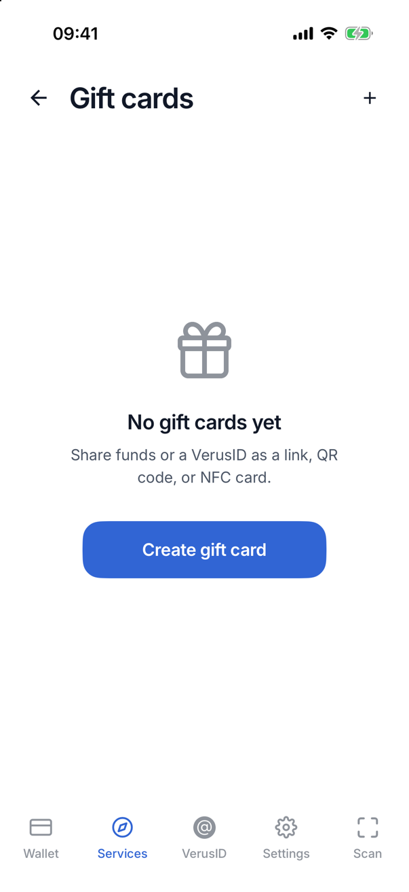 | 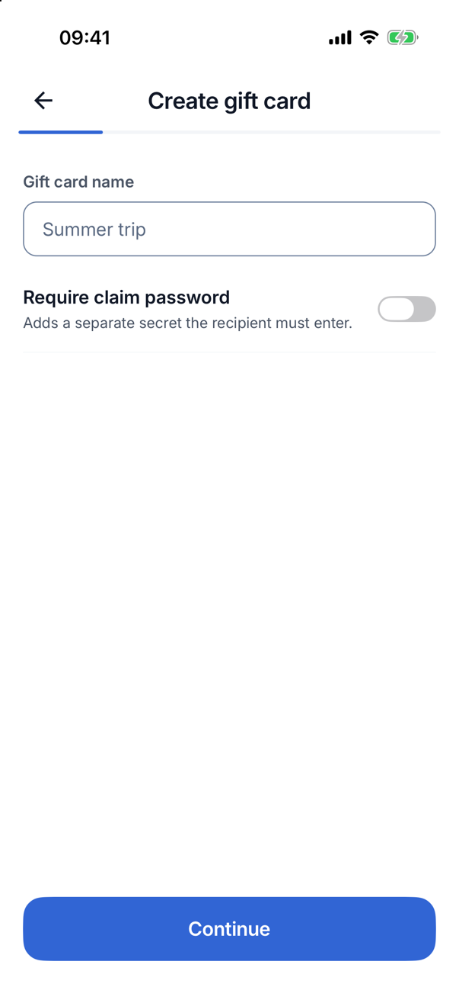 | 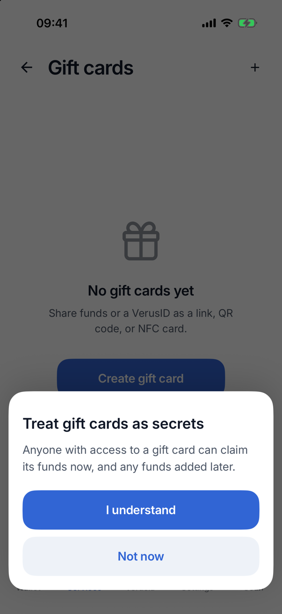 |

| Address book, empty state |
|---|
| 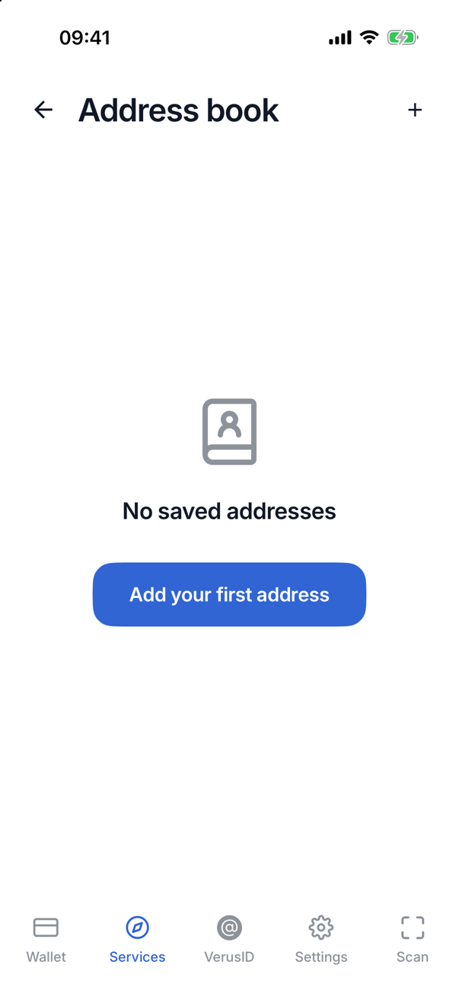 |

### 2.9 Scan

**Now.** The Scan tab opens a camera window with a torch. A scanned payment QR opens the Send wizard at Amount or Confirm with the invoice fields filled. An inactive asset in an invoice offers to add the asset. A `verus://` request opens the request review. Devices with NFC show "Scan NFC card"; the camera stops while the NFC read screen is open.

**Why.** Reason not recorded beyond the design owner's approval of the camera window.

**Main files.** `src/containers/VerusPay/VerusPay.js`, `src/components/BarcodeReader/BarcodeReader.js`, `src/containers/SendWizard/scanRequest.js`, `src/utils/QrScanner/QrScanner.js`.

**Not changed underneath.** QR parsing rules (`processVerusQr`); only error fields are added.

**Try it.** Scan a Receive slip from a second wallet. Scan a request QR. Scan an invoice for an asset that is not active.

| Scan on a simulator (no camera) |
|---|
| 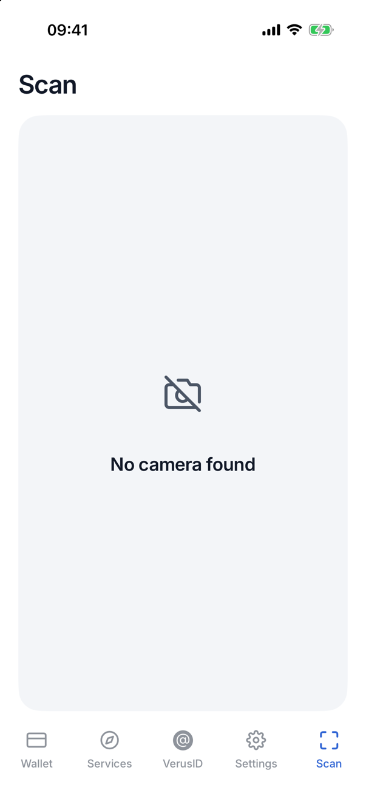 |

### 2.10 Settings

**Now.** Settings is a tab. The root shows the wallet (name and avatar, "Wallet appearance") and five groups: Security & recovery (password, biometrics, recovery secrets with screenshot protection on Android, keychain encryption), General, Appearance (System, Light, Dark), Network & storage ("Clear cache" and, with a private wallet open, "Clear blockchain data"), App information. Choices open sheets, not native pickers. A failed save shows on its row. Editing a text field in a sheet keeps the cursor in place. The address blocklist screen and routes are hidden; the blocklist itself still loads at sign-in and still blocks sends (`6dc800a9`: "Keep login refresh and send checks intact").

**Why.** Native alerts and pickers were replaced so that results and errors show on the screen where they happen (`525aef5c`). Review R12: the cursor jumped while the user edited a custom RPC server (`0ccc199f`, `8596afae`). F12: a cache clear must not force a private wallet resync. Reason for hiding the blocklist screen: not recorded.

**Main files.** `src/containers/RootStack/SettingsStackScreens/SettingsStackScreens.js`, `src/containers/Settings/components/` (`SettingsScaffold.js`, `SettingsFieldSheet.js`, `WalletAppearanceSheet.js`), `src/containers/Settings/`, `src/containers/DisplaySeed/DisplaySeed.js`, `src/components/RecoverySecretsPrivacyGuard.js`.

**Not changed underneath.** Password change, profile deletion, key derivation version. Changed: `deleteProfile` also deletes the new per-account data ([LOGIC_CHANGES.md](LOGIC_CHANGES.md#storage-and-migrations), storage 9); settings shape and the encrypted display choices ([storage 7](LOGIC_CHANGES.md#storage-and-migrations)).

**Try it.** Switch appearance with the phone in the other mode. Open recovery secrets and take a screenshot (Android blocks it). Change the display currency.

The Network and storage screenshot shows one clear button (2026-11-16); the screen now has two.

| Settings | Settings, dark | Security and recovery | General |
|---|---|---|---|
| 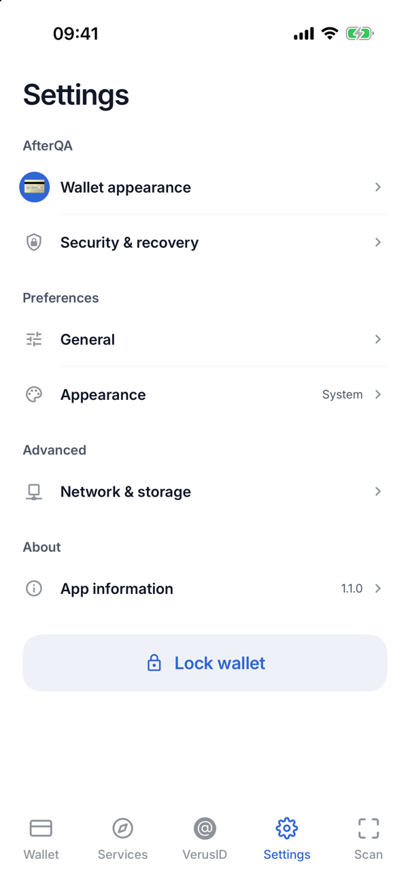 | 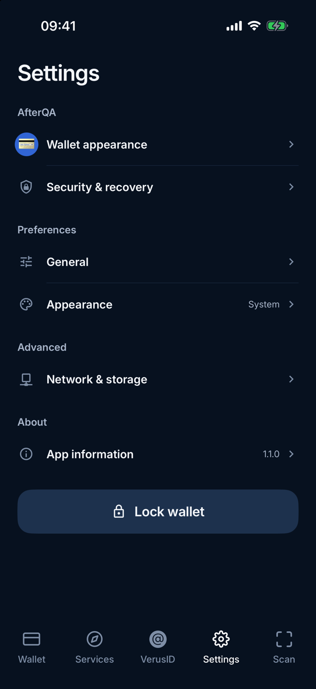 | 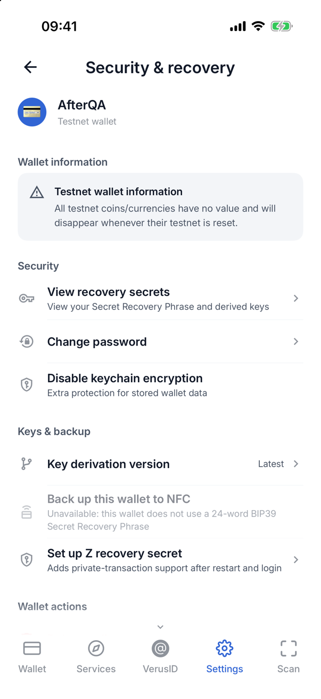 | 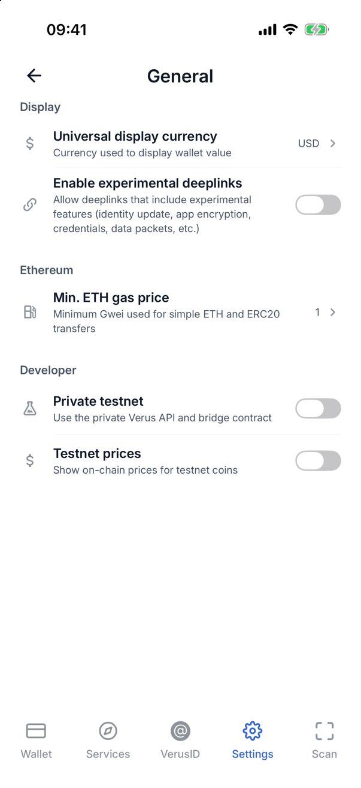 |

| Appearance | Network and storage |
|---|---|
| 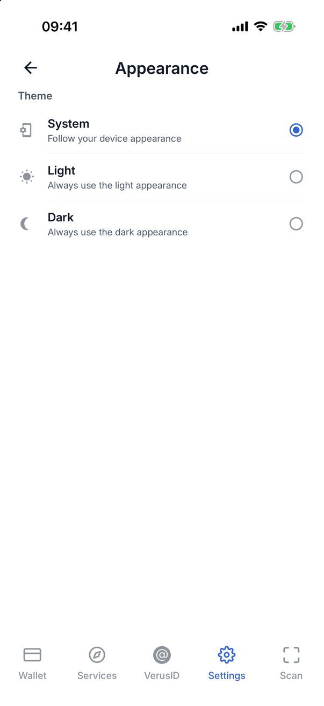 |  |

### 2.11 Alerts and error messages

**Now.** `createAlert` shows the app alert sheet (`AcknowledgeSheet`) instead of a native alert; its default button is "Close". Many former alerts are gone: wrong password shows on the password field, a setting that does not save shows on its row, success alerts after biometrics, wallet creation and deletion are removed because the screen shows the result. Confirmations stay as sheets. Error text is plain; technical detail goes to the log.

**Why.** An audit of 303 `Alert.alert` calls found that 140 could not run, 26 repeated the screen, 75 belonged on their screen, 18 were confirmations and 39 were errors that stay.

**Main files.** `src/components/Alert.js`, `src/components/AcknowledgeSheet.js`, `src/actions/actions/alert/dispatchers/alert.js`.

**Not changed underneath.** Which conditions show an error. A few call sites still use `Alert.alert` (for example network warnings in `VerusPay.js`).

### 2.12 Shared design system

**Theme.** `src/theme/onboarding/tokens.js` defines semantic colors (`textPrimary`, `surfaceMuted`, `link`, status tones) and typography roles for light and dark. `AppThemeProvider` reads the Appearance setting (system, light, dark), builds an MD2 Paper theme from the tokens for untouched Paper components, sets the status bar, and on iOS sets the window appearance so native controls match.

**Typography.** Inter in nine weights (`assets/fonts/`, `android/app/src/main/assets/fonts/`). `applyGlobalTypography` gives every `Text` and `TextInput` the Inter file for its weight. Font scaling stays off, as in upstream. Roles are listed in [`TYPOGRAPHY.md`](../../TYPOGRAPHY.md).

**Components.** See [section 3](#3-architecture-notes).

**Icons.** `lucide-react-native` line icons; Feather stays for the tab bar. No decorative icons; icons do a navigation, status, copy or recognition job.

**Safe areas and keyboard.** `react-native-safe-area-context` everywhere; bottom actions in `SafeBottomActionStack`; forms with bottom actions in `KeyboardAvoidingForm`. `pnpm check:safe-areas --changed` flags `SafeAreaView` from `react-native` and absolute bottom offsets.

**Light and dark.** `Info.plist` no longer forces Light. Every redesigned screen is meant to work in both themes.

## 3. Architecture notes

### Theme provider replaces `PaperProvider`

`App.js` used to wrap the app in `PaperProvider` with a Source Sans Pro font config, outside the Redux `Provider`. Now:

```
Provider (Redux)
  AppThemeProvider          src/theme/app/AppThemeProvider.js
    OnboardingThemeProvider src/theme/onboarding/OnboardingThemeProvider.js
      PaperProvider (MD2, built from tokens)
        NavigationContainer (theme from src/theme/app/navigationTheme.js)
```

The theme provider must sit inside Redux because it reads `settings.generalWalletSettings.appearance`. Screens read tokens through `useOnboardingTheme()` (the name is historical; it is the app theme).

### Navigation

- No drawer. `SignedInStackScreens` renders `MainStackScreens` directly.
- `MainStackScreens` (stack): `Home` (the tab navigator), `CoinMenus`, `ManageAssets`, `AddAssetByIdentifier`, `ReceiveAssetsList`, `ReceiveAssetDetails`, `SendWizard`, `DisplaySeed`, `NfcBackup`, `ResetPwd`, `DeleteProfile` and others.
- `HomeTabScreens` (`@react-navigation/bottom-tabs`): Wallet (`WalletStackScreens`), Services (`ServicesStackScreens`), VerusID (`IdentityStackScreens`, new), Settings (`SettingsStackScreens`, new), Scan (`VerusPay`).
- `IdentityStackScreens` holds `Identity`, `VerusIdDetails`, `IdentityRegistration`, `IdentityManagement`, `LinkIdentities`. Upstream registered the last three in `ServicesStackScreens`.
- `DeepLinkStackScreens` no longer registers `AuthenticationRequestIdentity`, `GenericRequestComplete` and `InvoicePaymentConfiguration`; no code navigates to them.
- Headers: `createRedesignedHeaderOptions` (`src/utils/navigation/header.js`) with the arrow back button. `index.js` turns on `enableFreeze(true)`; a patch to `@react-navigation/stack` freezes covered cards only after their transition ends.

### Shared components

All in `src/components/` unless noted. Style modules are in `src/styles/components/`.

| Need | Component |
|---|---|
| Buttons and text actions | `AppButton` (primary, secondary, text), `TextAction` |
| Bottom sheets | `BottomSheetModal`, `SelectionSheet`, `InfoSheet`, `InfoSheetSection`, `AcknowledgeSheet`, `DraggableSheet`, `SheetScrollView`, `useSheetDismissal` |
| Stepped tasks | `ProgressHeader`, `StepGlyph`, `SafeBottomActionStack`, `KeyboardAvoidingForm` |
| Inputs | `AppTextInput`, `AppAddressInput`, `AmountInput`, `AmountKeypad`, `AppSearchField`, `AppSearchLauncher`, `AppSwitch`, `AddressBookPicker` |
| Status and feedback | `StatusBadge`, `SkeletonLoader`, `EmptyState`, `TransactionResult`, `CopyAction`, `CopyFeedback`, `NeutralCheckMark` |
| Confirmation | `SlideToConfirm` |
| Privacy | `PrivacyBlurredText`, `RecoverySecretsPrivacyGuard`, `StartupCover` |
| Shell | `SignedInActionBar`, `HeaderCloseButton`, `HeaderContextBand`, `OnboardingBackButton`, `WalletAvatar`, `WalletUnlockCoordinator`, `NfcTap/`, `WalletSetup/` |
| Requests | `src/containers/DeepLink/components/RequestReview/` (`RequestCard`, details sheets) |

`DESIGN.md` names the canonical example for each pattern. `pnpm check:design` checks required sections, source fragments and banned patterns (iOS back title, left accent bars, repeated titles).

### New native modules

| Module | Platforms | What it does | Used by |
|---|---|---|---|
| `PrivacyBlurredText` (view) | iOS, Android | Draws text blurred for hidden balances. | `src/components/PrivacyBlurredText.js` |
| `VerusScreenSecurity` | iOS, Android | Android: `FLAG_SECURE` while recovery secrets show. iOS: reports screen capture state. | `RecoverySecretsPrivacyGuard.js` |
| `MainActivity.observeKeyboardResize` | Android | Sends a second `keyboardDidShow` when the keyboard height changes (Gboard number pad). | `KeyboardAvoidingForm.js`, keyboard listener |
| `VerusRootViewController` | iOS | Posts the appearance-change notification. Reason not recorded; may duplicate React Native. | `AppDelegate.mm` |

Both Android modules register in the existing `VerusKeepAwakePackage`.

### New dependencies and the patch

| Item | Reason |
|---|---|
| `@react-navigation/bottom-tabs` 6.6.1 | The tab bar. The v6 line matches the other navigation packages. |
| `lucide-react-native` 1.17.0 | Line icons; draws with the existing `react-native-svg`. Needs `mjs` in `metro.config.js`. |
| `react-native-video` 6.19.2 | Background video on Landing and Login. Adds a Swift pod (glog modular headers) and Media3 on Android, forced to 1.4.1 in `android/build.gradle` because AGP 7.4.2/R8 cannot dex 1.8.0. |
| `patches/@react-navigation+stack+6.3.4.patch` | Freezes a covered stack card only after its transition settles; ignores stale opening and closing keys after a reset. Applied by the existing `postinstall` (`patch-package`). Checked by `scripts/check-stack-freeze.cjs`. |

## 4. Known gaps and risks

1. **Jest is not fully green.** 3 unit tests fail: 2 tests of the upstream registration start screen, which the redesign does not have, and 1 `giftCard` test that also failed on upstream. The live CoinPaprika tests fail on both sides (rate-limited service). See [Jest status](DIFFERENCES_FROM_UPSTREAM.md#jest-status).
2. **Legacy files stay unmounted.** For example `LegacyHomeTabScreens.js`, `SideMenu/`, `ProfileStackScreens/`, `Home/Home.render.js`, `Services/Services.render.js`, `Coin/DynamicHeader.js`, `SubWalletSelect/SubWalletSelectorModal.js`, legacy `SendCoin`, `ConvertCoin`, `ReceiveCoin`. They still compile and add review noise. Deleting them is not part of this PR.
3. **Older button style still reachable in two places.** `LinkIdentityForm` (v1 login requests) and the `TraditionalCryptoSend` steps (older scan paths). See [DIFFERENCES_FROM_UPSTREAM.md](DIFFERENCES_FROM_UPSTREAM.md#decisions-by-the-design-owner).
4. **Electrum follows upstream.** Electrum coin selection still spends unconfirmed outputs and keeps the 546 sat minimum. At 1 sat/vB, strict nodes refuse a BTC send because upstream's coin selection sizes an input one byte short. Both are upstream code; they are questions to the reviewer.
5. **Convert request load.** Convert asks up to 30 `estimateconversion` per amount pause, 30 more per "Check 30 more routes" tap, and one retry on Confirm. This is above upstream, which estimates only in preflight (F14).
6. **Timeouts and status unknown.** Every VRPC and VerusID call stops after 30 s. A send whose broadcast fails with -32603 shows "status unknown" even if the node refused it.
7. **Plain storage.** New data that names the user is encrypted or in memory. Upstream's own plain stores (`vrpc_response`, `identities`, `claims`, `attestations`, `activeCoins`, `widgets`) are not changed. The new plain `vrpc_saved_*` stores hold public chain data only.
8. **Registration waiting.** A registration job keeps waiting without an error when the server's tip and commitment reads never agree.
9. **Testnet tokens on Goerli.** User-added testnet ERC-20 tokens saved with `network: 'goerli'` are not migrated to Sepolia; their provider lookup throws.
10. **Global patches.** `enableFreeze(true)`, the stack patch and the render patches on `Text`, `TextInput` and `Switch` can break on a React Native or React Navigation upgrade.
11. **Android build pins.** Media3 1.4.1 under a library built for 1.8.0; guava `33.0.0-android`.
12. **Assets size.** Inter is shipped twice (iOS and Android folders, about 12 MB). The background video is about 0.9 MB.
13. **Not checked.** The `mapped_to` addresses of the three new Verus stablecoins.
14. **Check scripts are not in CI.** There is no CI file.

## 5. How the work was verified

Only what a record shows is listed here. Source reading and device runs are kept apart.

### Static checks

- At `49fe2b8c`, the iOS and Android production JS bundles build. At the last code commit `263473d8`, `check:design` passes. The commits after `49fe2b8c` change only test files, `AGENTS.md` and this guide, so the bundles are the same.
- At `01996b42` (before the Jest repair and the later fixes), these passed: `check:design` (39 canonical sources; card palette contrast minimum 5.014:1), `check:identity-authority-funding`, `check:search-fields`, `check:send-wizard-options`, `check:safe-areas --changed`, `scripts/check-generic-request-completion-flow.js` (11 cases), `scripts/check-stack-freeze.cjs` (iOS and Android modes).
- Four other check scripts failed at that point because they compared old text or outputs. They are removed from this PR (`a29c8c91`).
- A relative-import scan found 0 unresolved imports in `src`, `App.js` and `index.js`.
- When the flag was removed (`da562817`), iOS and Android production JS bundles built. An Android release bundle also built for the last request fixes.
- 2026-11-24, trial merge of the PR branch with `redesign` `c82b61e9`: `check:design` passes; `check:safe-areas` reports only a known legacy file.
- Round 1 (`eed6316a`): `check:design` and `check:safe-areas --changed` pass; the iOS release JS bundle builds; the Android debug build ran on the test phones. ESLint does not load in this repository (plugin error), so lint did not run.

### Jest

On 2026-11-24 the unit suites ran on the trial merge of this PR branch with `redesign` `c82b61e9` and upstream `430268ad`, without the live-network folders: 2979 of 2982 tests pass. The 3 failures are the 2 registration start screen tests and 1 `giftCard` test that also failed on upstream `525aa859` (2026-11-16).

Earlier full runs: upstream ran on 2026-11-16: 2630 of 2773 pass. The PR branch ran three times at `263473d8` on 2026-11-17, each time with the same result: 2642 of 2813 pass. Compared per test name, 25 tests pass on upstream and fail here: 23 live CoinPaprika tests and 2 tests of the upstream registration start screen. No other unit test fails only here. 63 upstream test names are ported to the redesigned screens under new names, renamed to the intended behavior, or removed with removed behavior. Details per suite: [Jest status](DIFFERENCES_FROM_UPSTREAM.md#jest-status).

The suites were updated for the redesigned screens (shared setup in `debug/setupJest.js`, helpers in `src/tests/helpers/`). Where a test found upstream behavior that the redesign had lost, the product was fixed.

### Fixes found by the upstream tests

| Commit | File | Behavior now and why |
|---|---|---|
| `88da2b89` | `SignedInVerusIdDetails.js` | Unlink, Transfer and Modify re-check the session that opened the options sheet; a stale session cancels the action. Without it, a queued Unlink could remove the link from the wrong profile; upstream's `VerusIdServiceOverview.js` did this. |
| `5d4f5860` | `VerusIdOptionsSheet.js` | The first chosen action wins when a second tap comes during the sheet close, as upstream; the second tap replaced it. |
| `0f3c634b` | `Home.js` | An ordinary asset with no cards does not open while its cards rebuild, as upstream; the asset screen showed an empty card chooser. A pre-launch currency still opens. |
| `920fda51` | `SignedInCoinDetail.js`, `CoinMenus.js` | The card chooser opens only on a focused screen with a signed-in account and at least one card, as upstream. It showed behind other screens and after sign-out. |
| `06a4f364` | `IdentityManagementScreens.js` | A Transfer error shows above the fixed "Review transfer" button. On small phones it stayed below the visible area. |
| `c76a2671`, `74a10cc4` | `RegistrationStorageNotice.js`, `SignedInVerusIdService.js` | Unreadable registration storage shows a notice with "Try again" and "Clear all registration data". Before, saved registrations disappeared with no message and no way to recover. Signed or broadcast registrations still cannot be deleted one by one. |
| `cdfa403e` | `RegistrationScreens.js` | No "Preparing…" while a saved commitment review only loads, because the screen only reads saved data then. |
| `b29f108e` | `ContentStep.js`, `VerusIdContentChangeCard.js` | The identity update Content step shows upstream's warning again: "On-chain history persists, even after content is removed." The redesign had lost it. |

Evidence: unit tests `identityActions`, `homeSessionTransitions`, `coinMenuWalletLifecycle`, `identityManagementScreens`, `identityRegistrationScreens` and `identityContentReviewScreen`; both production JS bundles build; `check:design` passes. Rendered on the iOS Simulator with a forced state, each in light and dark: the registration storage notice, its confirmation sheet and the Transfer footer error. The storage notice was rendered again after the label fix `74a10cc4` (2026-11-17, forced state): the "Try again" label is fully visible in light and dark, and a tap on it keeps the notice without a crash. What ran on a device and what did not is listed below.

### Independent review of the late fixes

A second model reviewed the nine fix commits on 2026-11-17. It read the callers; it did not use a device. It found no regression in the session guards, the options sheet, the card chooser guard, the Transfer error, the loading text and the Content note. A data refresh does not cancel a valid Transfer, Modify or Unlink; only authentication, sign-out or a password reset does. "Clear all registration data" has no path around its confirmation.

It reported two limits. They are not fixed in this PR:

- `0f3c634b` (plausible, not reproduced): for a pre-launch currency that has no cards, if the launch lookup fails once, a tap on its Home row does nothing until Home gets focus again. Before the guard, the tap opened the asset screen.
- `c76a2671` (confirmed in the source): after "Try again" on the storage notice, the notice hides while the read runs. With a slow read, "No VerusID yet" can show until the read ends.

It also noted two limits of the new tests: the registration storage cases mount the notice in a substitute tab, and the cancel and dismiss cases call the cancel callback directly, so they do not prove the backdrop or Android Back wiring.

### Device runs

All device runs used the public VRSCTEST testnet (some also a private test chain) and disposable test wallets. No mainnet wallet was used.

- **Devices.** iOS Simulator: iPhone 17 Pro and iPhone SE (iOS 26). Android emulators: a 360x640 phone and a normal phone (Pixel 8, Android 15, in earlier rounds; Pixel 9 in later rounds). Most areas were checked in light and dark mode.
- **Per-area rounds.** Most merged areas record their own device check in the history. Examples: asset card stack on iPhone 17 Pro, iPhone SE and Pixel 8 (2026-11-03); request card and item approval on iPhone 17 Pro, iPhone SE and Android 360x640 (2026-10-28/29); network fee choice on iOS normal and SE with four real Sepolia ETH sends (2026-10-21).
- **End-to-end runs.** 2026-10-27: batch fixes and small screens on iPhone 17 Pro, iPhone SE and Android 360x640. 2026-11-05: 50 case runs on four phones, 47 pass, 2 fail, 1 skip; the failure (VerusID registration on default servers) was fixed in merge `ff2e63e0`. 2026-11-06 (VerusID focus): 232 case runs, 210 pass, 6 fail, 7 blocked, 9 skip; 0 P1 and 8 P2 findings. The fix batch is merge `0f10dad8`; it was re-checked on both Android phones and not re-run on iOS. Registration with two holds passed on all four phones.
- **Flag removal.** iOS Simulator smoke run: unlock, Home, asset detail, Receive, Send and Convert entry, all tabs, Settings, lock and unlock, with no error on screen or in Metro. Not run on Android.
- **Physical iPhone.** Request flows (identity update, provisioning) ran on a physical iPhone; 13 request and VerusID fixes followed and were checked on iOS Simulator (normal and SE) and on Android normal (light).
- **PR branch as an app (2026-11-17).** iOS 26.5 Simulator, JavaScript from the PR branch at `5299beb0` (the same app code as `263473d8`), with the env values of this PR: no Ethereum keys, public testnet server. Passed: unlock; Home total; asset screen and transaction sheet; quick repeated taps on an asset row (one screen opens, no empty card chooser); Receive; Send up to Confirm; Convert entry; Manage assets; VerusID list and page; the options menu (Transfer and Modify open, the Unlink sheet opens and was cancelled, a quick second tap opens nothing more); the New VerusID name step; Services; Scan; Settings; lock and unlock; dark mode on Home, the asset screen and the VerusID page. A real identity update request opened, showed the Content step note above the content change, and was left without approval. Seen because the build has no Ethereum keys: the Home notice "Could not connect" and one toast "no runners?!" from the Ethereum provider on the Send Amount step.
- **Round 1 review fixes (2026-11-18).** Android emulators (Pixel 9 size and 360x640, Android 16) and the iOS 26.5 Simulator, debug builds, VRSCTEST only. Passed: unlock to Home with the skeleton and no white page, light and dark; Add and Remove; asset Back; VerusID rows kept during a refresh; the signed legacy invoice header; an amount above the balance refused; a 0.1 VRSCTEST send confirmed; a 0.000001 VRSCTEST send accepted by the network; a mid-text edit of a custom RPC server; a paid invoice still marked after a restart; a storage scan that found no address, txid or balance in plain keys outside upstream's stores. The paid invoice and the real sends ran on Android only.
- **Review rounds (2026-11-19 to 2026-11-24).** Android emulators (a normal phone and a 360x640 phone) and the iOS Simulator, debug builds, VRSCTEST and Sepolia only. Recorded passes: 2026-11-19, ETH and ERC-20 (USDC) sends on Sepolia with the fee choice on Android, 21 of 22 cases; R13 balance cases on Android and iOS, with the Bitcoin Testnet4 pending line; the Home order, VerusID and wallet changes on Android, light and dark. 2026-11-20: Advanced form sends and Send from Home on Android with real VRSCTEST sends, and a second send before the next block that showed "Nothing new was sent". 2026-11-21: Home sort and Receive chooser on Android, one real VRSCTEST send. 2026-11-22: the Advanced form header menu on Android and iOS. 2026-11-24: the Advanced form up to Confirm on Android and iOS; the parity set re-checked on Android only.
- **Bitcoin Testnet4 (2026-11-19).** Real testnet4 sends ran. At 1 sat/vB a strict node refused a 1-input, 2-output send three times ("min relay fee not met, 225 < 226"); nothing was broadcast (upstream fee math, see section 4).
- **Send on the PR branch.** The Send wizard ran twice to Confirm (0.01 VRSCTEST to a VerusID of the same wallet, fee 0.0001 VRSCTEST from the testnet server). The final slide was not done: the test tool could not drag on that day. No file under `src/containers/SendWizard`, `src/utils/api/channels` or `src/utils/web3` changed after `af256d5d`, the commit before the pull request was prepared.

### Not verified on a device

- NFC reads and writes on a physical card for every entry (Android emulators have no NFC). R16 has no real-card test.
- A release build on a real phone for the Home scroll and the white page (R1, R9, I4).
- Pay with on a tagged invoice (R10); one scan of a real QR code on a phone (TX3); fiat entry on ETH (TX1: no fiat price on Sepolia); a pre-conversion (TX2: none on public VRSCTEST).
- "No resync after Clear cache" with a synced private card (F12).
- The Advanced form parity set of 2026-11-24 on iOS.
- The trial merge of the PR branch as an app. The last app run of the PR branch itself was on 2026-11-17.
- Any mainnet flow.
